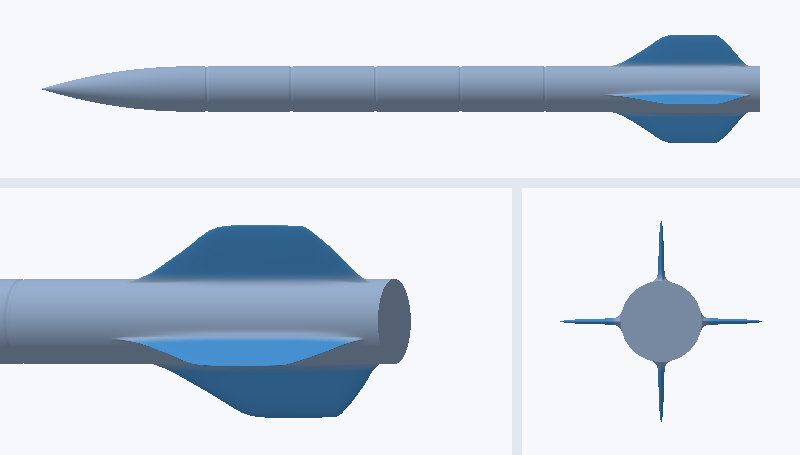

# RocketDildas � Pioneer 10K Portfolio

A mechanical design and simulation portfolio for the RocketDildas competition project. This page shows a CAD preview and selected plots from the preliminary OpenRocket review.

## CAD visualization

The Pioneer 10K v3 display model shows the external airframe in side and rear views, with a close-up of the aft section.

## Preliminary OpenRocket results

| Plot | Wind setting | What it shows |
| --- | --- | --- |
| Altitude vs. time | 2 m/s | Altitude trace from ignition through the end of the displayed window |
| Stability vs. time | 0 m/s | Stability margin and the plotted center of gravity (CG) and center of pressure (CP) positions |

### Altitude � 2 m/s wind

The displayed trace reaches approximately **3,850 m near 29 s**, as read from the plot. The chart marks motor ignition and burnout.

[Download the one-slide PowerPoint summary](slides/Wind-2ms-Altitude-Simulation.pptx?raw=true)

### Stability � 0 m/s wind

The left axis reports stability margin in calibers. The right axis reports CG and CP positions in centimeters. An event marker labels apogee and recovery deployment for this run.

The two plots show different quantities under different wind settings. Both are preliminary simulation outputs. The CAD image is labeled by display-model revision and shown as a separate artifact.

---

**???????????** � ?????? CAD ??? Pioneer 10K v3 ??????????????????? 2 m/s ????????????????????? 0 m/s ???????????????????????

