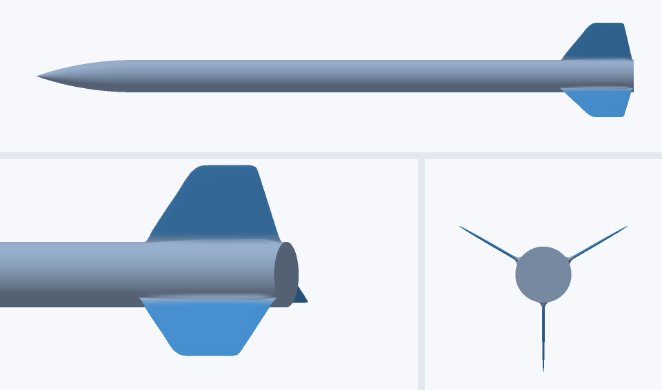
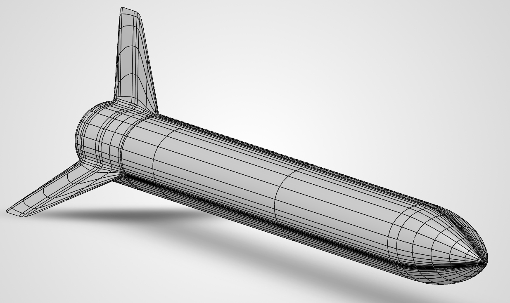
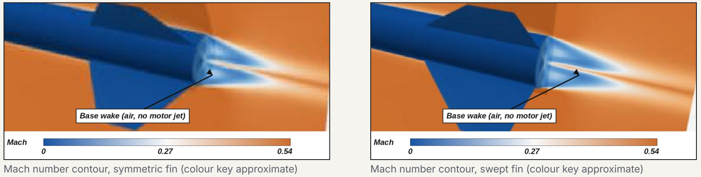
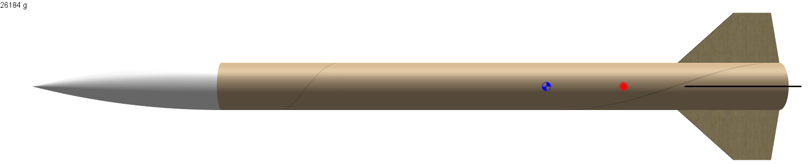
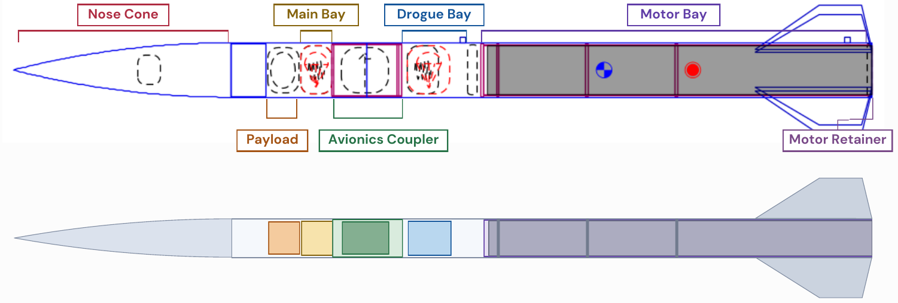
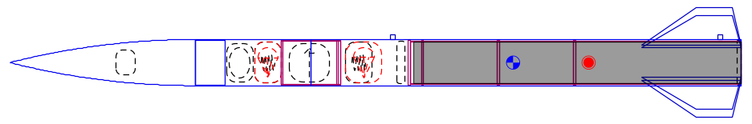
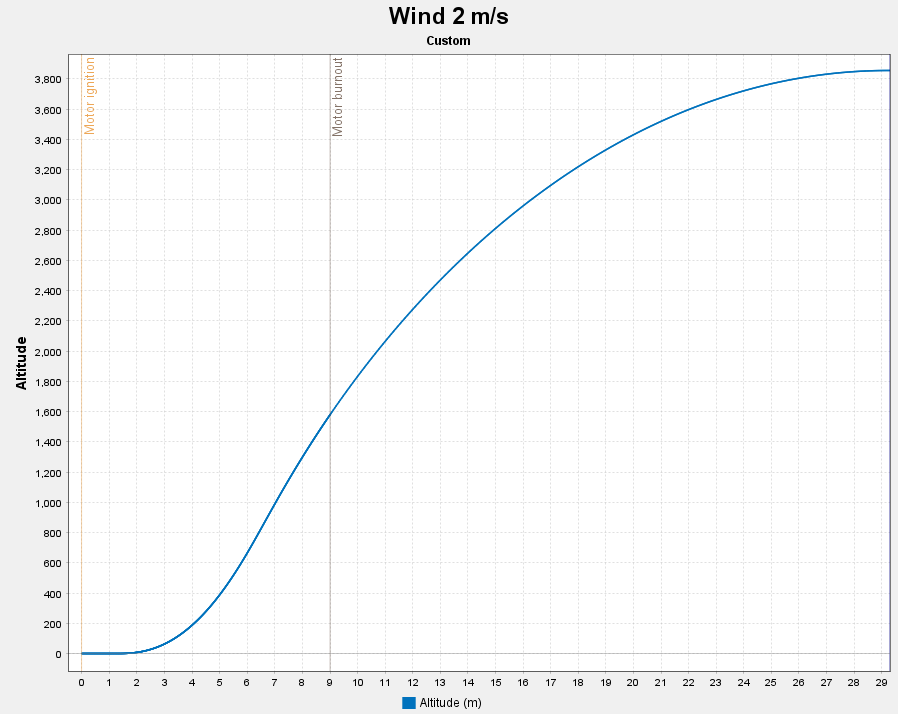
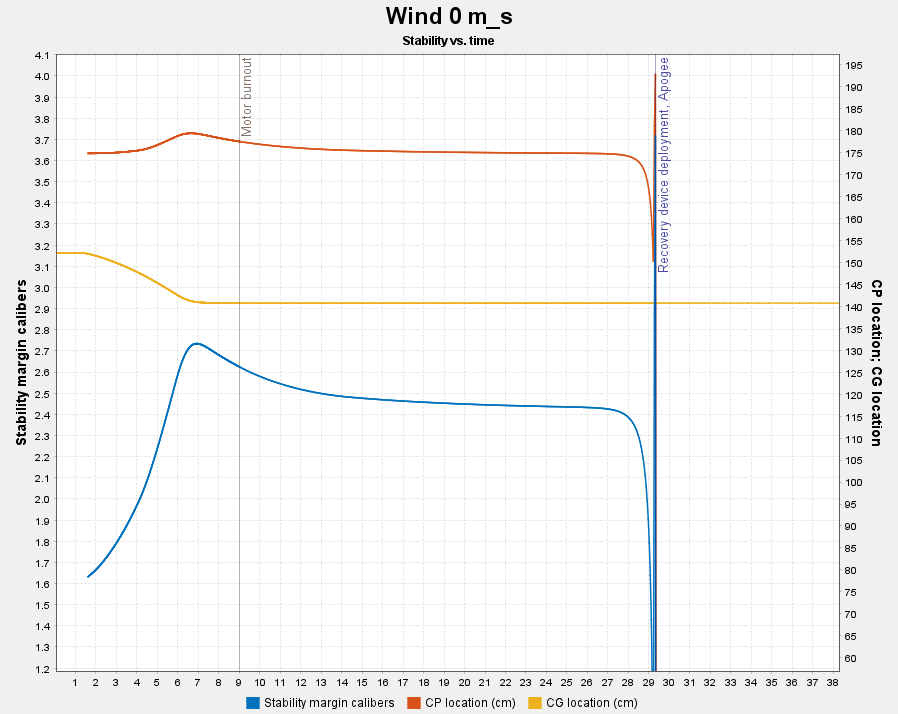

# RocketDildas | Pioneer 10K Portfolio

Mechanical design and simulation work for the RocketDildas competition project. This portfolio shows fin modeling in SOLIDWORKS, the Pioneer 10K vehicle layout in OpenRocket, and selected results presented at the Mission Design Review.

[Pioneer 10K v3 CAD preview](#pioneer-10k-v3-cad-preview) · [OpenRocket vehicle layout](#openrocket-vehicle-layout) · [Simulation results](#preliminary-openrocket-results) · [Presentation material](#presentation-material)

### Pioneer 10K v3 CAD preview

The RocketDildas 3K CAD study shows the fin profile, the fin-to-airframe transition, and the arrangement of the fins in rear view.

[Download the RocketDildas 3K display model (.step)](models/RocketDildas-3K-Fin-Display.step?raw=true)

### 3D CAD surface view

The angled view makes the fin profile and the transition between the fins and the body visible.

### CFD comparison of symmetric and swept fins

The RPL study reported similar airflow around both fins and about **0.8% difference in fin drag** for the single case shown. The blue region behind the body shows slower air in the base wake. The comparison used a thin-plate fin model. Figure excerpt from *Fin Design — Swept vs Symmetric (RPL CFD)*, page 1.

## OpenRocket vehicle layout

The OpenRocket 3D view shows the exterior profile. Blue marks the center of gravity (CG), and red marks the center of pressure (CP).

### Pioneer 10K v4 layout from the design review

The diagram identifies the main vehicle sections and shows how the payload, avionics, and recovery bays are presented in the cutaway. Figure from the ORBITL Mission Design Review, page 9.

View the original OpenRocket side schematic

## Preliminary OpenRocket results

| Plot | Wind setting | What it shows |
| --- | --- | --- |
| Altitude vs. time | 2 m/s | Altitude trace from ignition through the end of the displayed window |
| Stability vs. time | 0 m/s | Stability margin and the plotted center of gravity (CG) and center of pressure (CP) positions |

### Altitude - 2 m/s wind

The displayed trace reaches approximately **3,850 m near 29 s**, as read from the plot. The chart marks motor ignition and burnout.

[Download the PowerPoint slide used in the project presentation](slides/Wind-2ms-Altitude-Simulation.pptx?raw=true)

### Stability - 0 m/s wind

The left axis reports stability margin in calibers. The right axis reports CG and CP positions in centimeters. An event marker labels apogee and recovery deployment for this run.

The two plots show different quantities under different wind settings. Both are preliminary simulation outputs. The CAD image is labeled by display-model revision and shown as a separate artifact.

## Presentation material

The PowerPoint file in this repository is the altitude-simulation slide used in the project presentation.
